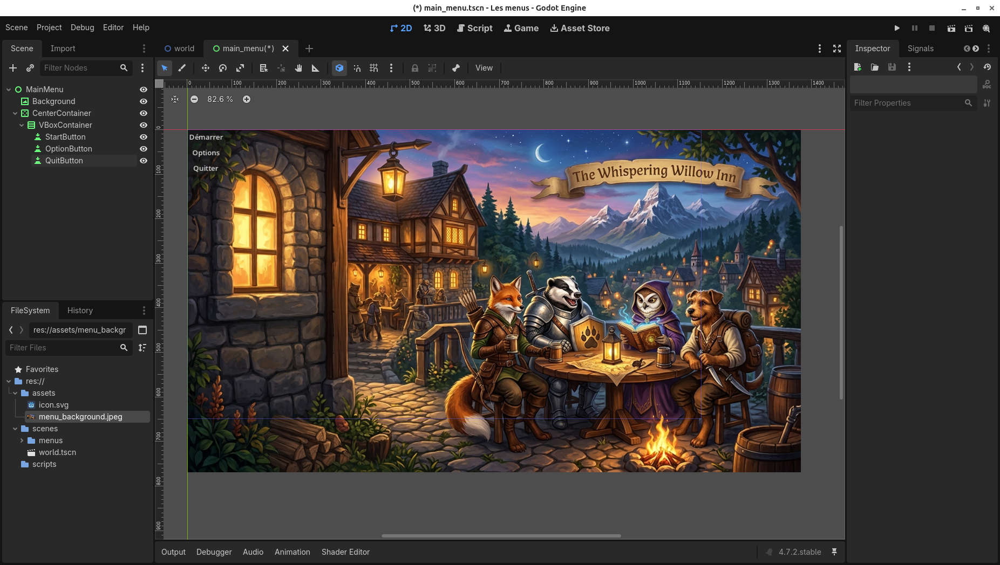
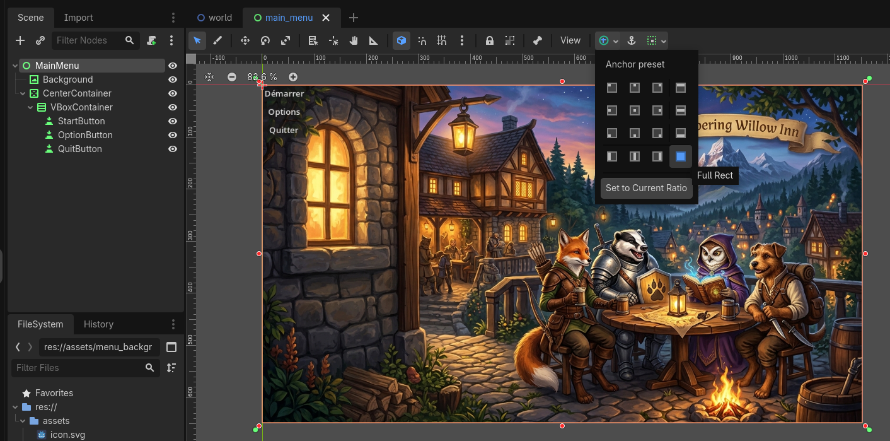
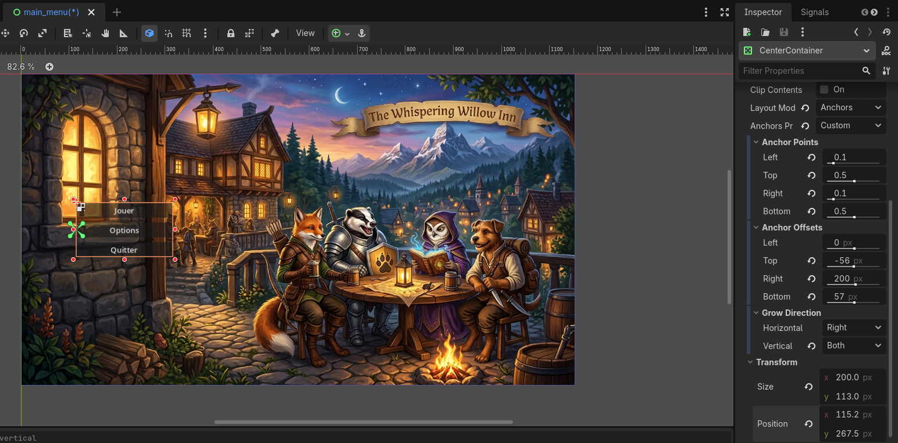
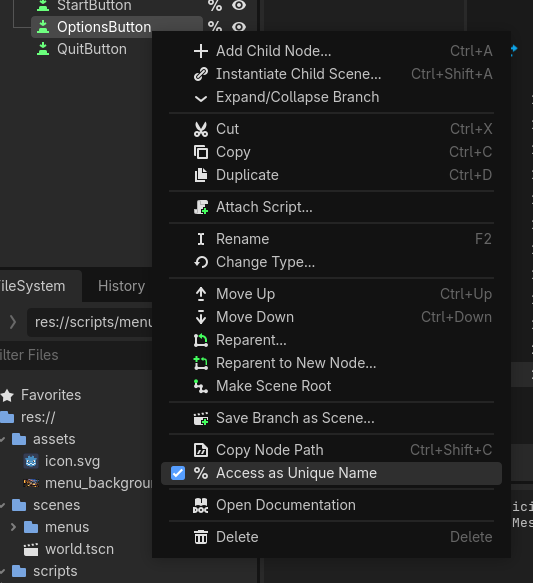
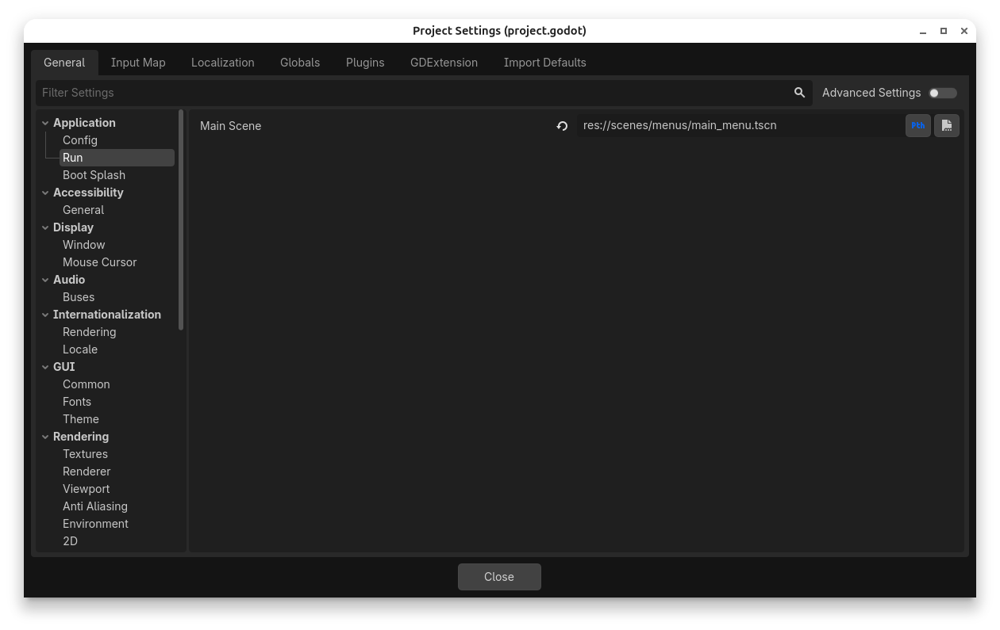
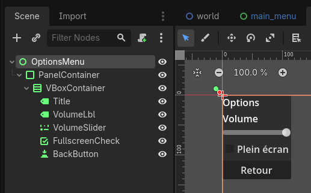
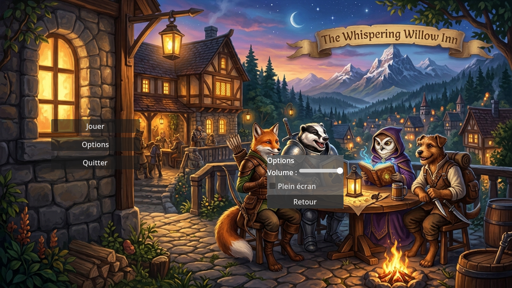
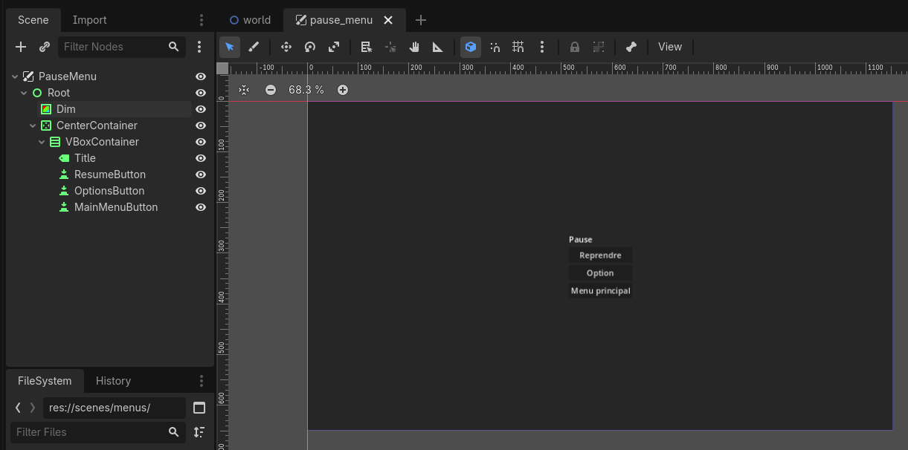
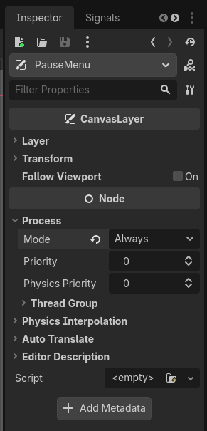

# Les menus

Dans cette leçon nous allons voir comment créer un menu de jeu simple. Nous allons créer un menu principal avec des boutons pour démarrer le jeu, accéder aux options et quitter le jeu. Nous allons également voir comment gérer la navigation entre les différents écrans du menu.

## Objectifs

- Construire un écran de menu avec les nœuds `Control` et les conteneurs.
- Réagir aux clics de boutons à l'aide des signaux.
- Changer de scène à partir du menu (démarrer le jeu, revenir au menu).
- Afficher un sous-menu d'options.
- Ajouter un menu de pause par-dessus le jeu.
- Rendre le menu utilisable au clavier et à la manette.

## Structure du projet

Avant de commencer, voici l'organisation proposée. Chaque écran est une scène distincte, ce qui permet de les tester séparément avec `F6`.

```
res://
├── scenes/
│   ├── menus/
│   │   ├── main_menu.tscn
│   │   ├── options_menu.tscn
│   │   └── pause_menu.tscn
│   └── world.tscn
└── scripts/
    └── menus/
        ├── main_menu.gd
        ├── options_menu.gd
        └── pause_menu.gd
```

## Le menu principal

### L'arbre de scène

Le menu principal est une scène dont la racine est un nœud `Control`. On y ajoute un `VBoxContainer` qui place automatiquement les boutons les uns sous les autres.

```
MainMenu (Control)
├── Background (TextureRect ou ColorRect)
└── CenterContainer
    └── VBoxContainer
        ├── Title (Label)
        ├── StartButton (Button)
        ├── OptionsButton (Button)
        └── QuitButton (Button)
```



### Positionnement avec les ancres

Pour que le menu occupe tout l'écran peu importe la résolution, sélectionnez la racine `MainMenu`, puis dans la barre d'outils choisissez **Anchor preset → Full Rect**. Faites de même pour `Background` et `CenterContainer`.

Le `CenterContainer` garde son enfant centré. Inutile donc de calculer des positions à la main.



!!! tip
    Dans le `VBoxContainer`, la propriété `Theme Overrides → Constants → Separation` contrôle l'espace entre les boutons.


Si vous désirez positionner le menu à un endroit précis avec les ancres, vous pouvez modifier les propriétés de `Anchors Preset` dans l'inspecteur. Par exemple, j'ai choisi de centrer le menu verticalement et de le placer à 10% de la largeur de l'écran. Pour cela, j'ai réglé l'ancre de gauche à 0.1 et l'ancre du dessus à 0.5. Ensuite, pour centrer verticalement le menu, j'ai mis le `Grow Direction` vertical à `Both`.

!!! note
	Lorsque l'on modifie certaines propriétés, d'autres peuvent être automatiquement recalculées. Par exemple, si l'on modifie les points d'ancrage, la position et la taille du nœud peuvent être ajustées automatiquement. Il est donc important de vérifier les valeurs après avoir modifié les ancres pour s'assurer que le nœud est positionné comme souhaité.



### Le texte des boutons

Pour chaque `Button`, modifiez la propriété `Text` dans l'inspecteur : « Jouer », « Options », « Quitter ». La propriété `Custom Minimum Size` sous la classe `Control` permet de donner une largeur uniforme aux boutons.

### Le script

Attachez un script à la racine `MainMenu`. On connecte le signal `pressed` de chaque bouton dans `_ready()`.

```gd
class_name MainMenu
extends Control

@onready var start_button : Button = %StartButton
@onready var options_button : Button = %OptionsButton
@onready var quit_button : Button = %QuitButton

func _ready() -> void:
	start_button.pressed.connect(_on_start_pressed)
	options_button.pressed.connect(_on_options_pressed)
	quit_button.pressed.connect(_on_quit_pressed)

func _on_start_pressed() -> void:
	get_tree().change_scene_to_file("res://scenes/world.tscn")

func _on_options_pressed() -> void:
	pass # Voir la section sur les options

func _on_quit_pressed() -> void:
	get_tree().quit()
```

!!! note "Le symbole `%`"
    `%StartButton` fait référence à un nœud marqué comme **nom unique de scène** (clic droit sur le nœud → *Access as Unique Name*). Ainsi, le script ne brise pas si on déplace le bouton dans un autre conteneur.



!!! info "Connecter par l'éditeur"
    On peut aussi connecter les signaux à partir de l'onglet **Nœud → Signaux**. Le résultat est le même. Connecter par le code a l'avantage de tout garder visible au même endroit.

!!! warning "Quitter sur le web"
    `get_tree().quit()` n'a aucun effet dans un export web. Si votre jeu est publié sur itch.io en HTML5, cachez le bouton « Quitter » avec `quit_button.visible = OS.get_name() != "Web"`.

### Définir la scène de démarrage

Pour que le jeu s'ouvre sur le menu, allez dans **Projet → Paramètres du projet → Application → Run → Main Scene** et choisissez `main_menu.tscn`.



## Navigation au clavier et à la manette

Les `Button` gèrent déjà le focus. Les actions `ui_up`, `ui_down` et `ui_accept` sont configurées par défaut. Il suffit de donner le focus au premier bouton à l'ouverture du menu.

```gd
func _ready() -> void:
	# ... connexions des signaux
	start_button.grab_focus()
```

Sans cet appel, aucun bouton n'est sélectionné et les flèches ne font rien tant que la souris n'a pas cliqué.


!!! tip
    Les propriétés `Focus → Neighbor Top/Bottom` d'un bouton permettent de forcer l'ordre de navigation quand la disposition automatique ne convient pas.

## Le menu d'options

Deux approches sont possibles :

1. **Une scène séparée** chargée avec `change_scene_to_file()`. Simple, mais on perd l'état du menu principal.
2. **Un panneau dans la même scène**, que l'on montre ou cache. C'est l'approche utilisée ici, car le même panneau sera réutilisé dans le menu de pause.

### L'arbre de scène

```
OptionsMenu (Control)
└── PanelContainer
    └── VBoxContainer
        ├── Title (Label)
        ├── VolumeLabel (Label)
        ├── VolumeSlider (HSlider)
        ├── FullscreenCheck (CheckBox)
        └── BackButton (Button)
```

Pour le `HSlider`, réglez `Min Value` à 0, `Max Value` à 1, `Step` à 0.05 et `Value` à 1.



### Le script

Le menu d'options émet son propre signal `closed`. Ainsi, il ne sait pas qui l'a ouvert, et il fonctionne autant depuis le menu principal que depuis le menu de pause.

```gd
class_name OptionsMenu
extends Control

signal closed

@onready var volume_slider : HSlider = %VolumeSlider
@onready var fullscreen_check : CheckBox = %FullscreenCheck
@onready var back_button : Button = %BackButton

var master_bus : int = AudioServer.get_bus_index("Master")

func _ready() -> void:
	volume_slider.value_changed.connect(_on_volume_changed)
	fullscreen_check.toggled.connect(_on_fullscreen_toggled)
	back_button.pressed.connect(_on_back_pressed)

func open() -> void:
	show()
	volume_slider.grab_focus()

func _on_volume_changed(value : float) -> void:
	AudioServer.set_bus_volume_db(master_bus, linear_to_db(value))

func _on_fullscreen_toggled(enabled : bool) -> void:
	if enabled:
		DisplayServer.window_set_mode(DisplayServer.WINDOW_MODE_FULLSCREEN)
	else:
		DisplayServer.window_set_mode(DisplayServer.WINDOW_MODE_WINDOWED)

func _on_back_pressed() -> void:
	hide()
	closed.emit()
```

!!! note "Pourquoi `linear_to_db()`?"
    Le volume d'un bus audio est en décibels, une échelle logarithmique. Un curseur de 0 à 1 converti avec `linear_to_db()` donne une progression plus naturelle à l'oreille. Voir [Jouer des sons et de la musique](../c09_audio/index.md) pour les bus audio.

### Intégration au menu principal

Instanciez `options_menu.tscn` comme enfant de `MainMenu` et décochez sa visibilité. Mettez à jour le script du menu principal :

```gd
@onready var options_menu : OptionsMenu = $OptionsMenu

func _ready() -> void:
	# ... connexions précédentes
	options_menu.closed.connect(_on_options_closed)
	start_button.grab_focus()

func _on_options_pressed() -> void:
	options_menu.open()

func _on_options_closed() -> void:
	options_button.grab_focus()
```



!!! tip "Pour aller plus loin"
    Les options sont perdues à la fermeture du jeu. Voir [Sauvegarde de données](../c12_save_data/index.md) pour les conserver d'une session à l'autre.

## Le menu de pause

Le menu de pause s'affiche par-dessus le jeu. Il doit continuer à fonctionner pendant que le reste du jeu est figé.

### L'arbre de scène

On place le menu dans un `CanvasLayer` pour qu'il s'affiche au-dessus du jeu, peu importe la caméra.

```
PauseMenu (CanvasLayer)
└── Root (Control)          ← Full Rect
    ├── Dim (ColorRect)     ← noir, alpha ~0.5
    └── CenterContainer
        └── VBoxContainer
            ├── Title (Label)
            ├── ResumeButton (Button)
            ├── OptionsButton (Button)
            └── MainMenuButton (Button)
```



### Le `process_mode`

Quand `get_tree().paused` vaut `true`, Godot arrête tous les nœuds dont le `process_mode` est `Inherit` (par défaut). Le menu de pause serait donc figé lui aussi.

Sélectionnez la racine `PauseMenu` et réglez **Process → Mode** à `Always`. Ses enfants héritent de ce mode.



### Le script

```gd
class_name PauseMenu
extends CanvasLayer

@onready var resume_button : Button = %ResumeButton
@onready var options_button : Button = %OptionsButton
@onready var main_menu_button : Button = %MainMenuButton
@onready var options_menu : OptionsMenu = $OptionsMenu

func _ready() -> void:
	hide()
	resume_button.pressed.connect(resume)
	options_button.pressed.connect(options_menu.open)
	main_menu_button.pressed.connect(_on_main_menu_pressed)
	options_menu.closed.connect(options_button.grab_focus)

func _unhandled_input(event : InputEvent) -> void:
	if event.is_action_pressed("ui_cancel"):
		if visible:
			resume()
		else:
			pause()
		get_viewport().set_input_as_handled()

func pause() -> void:
	get_tree().paused = true
	show()
	resume_button.grab_focus()

func resume() -> void:
	get_tree().paused = false
	options_menu.hide()
	hide()

func _on_main_menu_pressed() -> void:
	get_tree().paused = false
	get_tree().change_scene_to_file("res://scenes/menus/main_menu.tscn")
```

!!! danger "Toujours dépauser avant de changer de scène"
    L'état `paused` appartient au `SceneTree`, pas à la scène. Si on change de scène sans remettre `paused` à `false`, le menu principal s'ouvre figé.

Instanciez ensuite `pause_menu.tscn` dans `world.tscn`.

!!! note "`ui_cancel`"
    L'action `ui_cancel` est liée à `Échap` par défaut. Pour la touche *Start* d'une manette, créez votre propre action `pause` dans **Projet → Paramètres du projet → Contrôles**.

## Personnaliser l'apparence avec un `Theme`

Modifier chaque bouton un par un devient vite pénible. Un `Theme` regroupe police, couleurs et styles (`StyleBox`) pour tous les contrôles.

1. Sélectionnez la racine du menu, puis dans la propriété `Theme`, choisissez **Nouveau Theme**.
2. Sauvegardez-le comme `res://ui/menu_theme.tres`.
3. Dans l'éditeur de thème (panneau du bas), personnalisez les styles de `Button` :

    - Cliquez sur le bouton `+` près de la liste des types, puis choisissez `Button`.
    - Ouvrez l'onglet **Styles**. Pour chaque état (`normal`, `hover`, `pressed` et `focus`), cliquez sur **Override** pour ajouter sa `StyleBox` au thème.
	- Sélectionnez une `StyleBox` pour la modifier dans l'Inspecteur. Par exemple, avec une `StyleBoxFlat`, réglez **Bg Color** et **Corner Radius** pour les trois premiers états, puis **Border Color** et **Border Width** pour rendre l'état `focus` visible.
    - Vérifiez les changements dans l'aperçu du thème : le bouton doit avoir une apparence distincte au repos, au survol et lorsqu'il est appuyé.
4. Assignez le même thème aux autres menus.

Voir aussi la documentation Godot sur [l'éditeur de thème](https://docs.godotengine.org/fr/stable/tutorials/ui/gui_using_theme_editor.html).

!!! tip
	L'état `focus` est dessiné par-dessus les autres styles. Utilisez surtout un contour, afin que le fond du bouton reste visible et que le joueur à la manette repère clairement la sélection.

## Résumé

- Un menu est une scène dont la racine est un `Control`. Les conteneurs (`CenterContainer`, `VBoxContainer`) gèrent la disposition.
- Le signal `pressed` d'un `Button` déclenche l'action.
- `get_tree().change_scene_to_file()` change d'écran. `get_tree().quit()` ferme le jeu.
- `grab_focus()` rend le menu navigable au clavier et à la manette.
- Un sous-menu qui émet son propre signal (`closed`) est réutilisable à plusieurs endroits.
- Un menu de pause utilise `get_tree().paused` et un `process_mode` à `Always`.

## Exercices

1. Ajoutez un bouton « Crédits » au menu principal qui ouvre un panneau avec vos noms.
2. Ajoutez un curseur de volume séparé pour la musique et les effets sonores (un bus par catégorie).
3. Ajoutez une transition en fondu (`Tween` sur `modulate:a`) lors du passage du menu au jeu.
4. Sauvegardez les options dans `user://` et rechargez-les au démarrage.

## Références

- [Documentation Godot — Size and anchors](https://docs.godotengine.org/en/stable/tutorials/ui/size_and_anchors.html)
- [Documentation Godot — Using Containers](https://docs.godotengine.org/en/stable/tutorials/ui/gui_containers.html)
- [Documentation Godot — Pausing games and process mode](https://docs.godotengine.org/en/stable/tutorials/scripting/pausing_games.html)
- [Documentation Godot — Introduction to GUI skinning](https://docs.godotengine.org/en/stable/tutorials/ui/gui_skinning.html)
